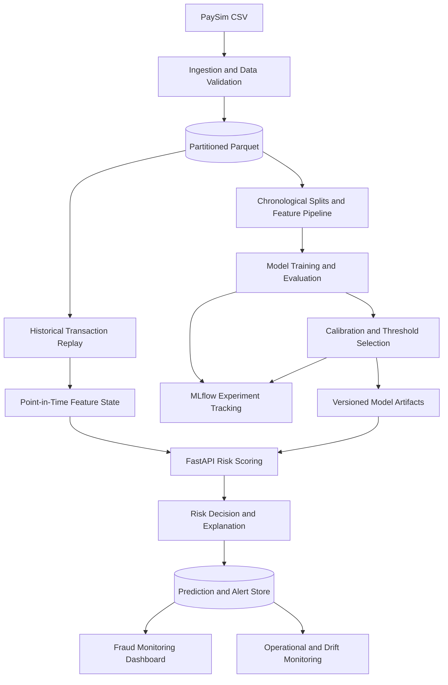

# Financial Fraud Detection & Risk Intelligence Platform

> An end-to-end machine learning system for detecting suspicious financial transactions, generating explainable risk scores, and supporting cost-sensitive fraud investigation decisions.

## 1. Project Overview

Financial institutions must identify fraudulent transactions while minimizing unnecessary declines, customer friction, and investigation costs. Because fraud represents a small fraction of transactions, traditional accuracy-based classification can hide poor detection performance.

This project will develop a production-oriented fraud detection platform using the PaySim mobile money transaction dataset. The system will combine temporal feature engineering, imbalanced classification, calibrated risk scoring, explainable AI, and simulated real-time transaction processing. Its primary objective is to demonstrate rigorous machine learning and the engineering needed to turn a model into a reproducible, monitorable decision-support system.

The project is an educational simulation, not a validated financial institution fraud control system. PaySim is synthetic; results cannot establish real-world fraud detection performance.

## 2. Problem Statement

Given a financial transaction and the account information available before a decision, estimate the probability that the transaction is fraudulent and assign an appropriate risk-based action.

The system should answer:

- How effectively can supervised and unsupervised models identify rare fraudulent transactions?
- Do historical behavioral features improve detection compared with basic transaction features?
- How can thresholds balance fraud losses against investigation workload and false positives?
- Which available transaction features contribute most to individual risk predictions?
- How can a trained model be served, monitored, and reproduced reliably?

## 3. Project Objectives

- Build a reproducible data ingestion, validation, and preprocessing pipeline for over six million transactions.
- Engineer point-in-time transaction and account-level features without using future or outcome-dependent information.
- Compare rule-based, statistical, and machine learning baselines against gradient-boosted models.
- Evaluate models on chronological holdout data using metrics appropriate for highly imbalanced classification.
- Calibrate predicted probabilities and optimize decision thresholds under explicit business-cost assumptions.
- Provide interpretable transaction-level risk explanations and model-level diagnostics.
- Deploy a prediction API, historical replay pipeline, and monitoring dashboard.
- Track experiments, version model artifacts, test critical components, and document reproducible execution.

## 4. Dataset

**Source:** [PaySim — Synthetic Financial Datasets for Fraud Detection](https://www.kaggle.com/datasets/ealaxi/paysim1)

PaySim simulates mobile money transactions using patterns derived from real financial transaction data. The published dataset contains 6,362,620 transactions over approximately 30 days, including 8,213 labeled fraudulent transactions (approximately 0.129%). These counts will be verified during ingestion.

| Field | Description |
| --- | --- |
| `step` | Simulated transaction time in hourly steps |
| `type` | Transaction category: CASH_IN, CASH_OUT, DEBIT, PAYMENT, or TRANSFER |
| `amount` | Transaction amount |
| `nameOrig` | Originating account identifier |
| `nameDest` | Destination account identifier |
| `oldbalanceOrg` | Originating account balance before the transaction |
| `newbalanceOrig` | Originating account balance after the transaction |
| `oldbalanceDest` | Destination account balance before the transaction |
| `newbalanceDest` | Destination account balance after the transaction |
| `isFraud` | Binary fraud label (prediction target) |
| `isFlaggedFraud` | Existing simulator rule-based fraud flag |

### Data limitations and leakage policy

- The dataset is synthetic and may contain simulator-specific fraud patterns that are easier to learn than real fraud.
- The dataset creator cautions that detected fraudulent transactions are canceled, making balance fields potentially outcome-dependent. All four balance columns will be excluded from the primary model, including any derived features using those columns.
- `isFraud` is the target only. `isFlaggedFraud` will be used solely as a rule-based benchmark, not as a predictor.
- Account IDs will be used as keys for historical aggregates, not fed directly into the model as high-cardinality identifiers.
- Hourly timestamps do not establish a reliable within-hour ordering. Primary historical features will therefore use strictly earlier time steps, and transactions within the same step will be scored before updating feature state for that step.
- No fraud labels from prior transactions will be used as online features; label availability and investigation delays are not documented.
- The 30-day window limits conclusions about seasonality, long-term drift, and repeated account behavior. Account-history coverage and unseen-account rates will be reported explicitly.
- Raw data will not be committed to Git. Download it from the source and follow its applicable license and usage terms.

## 5. System Architecture



The offline training and online scoring paths will share a documented feature contract. Historical replay will simulate incoming transactions; it will not connect to a live financial network. Actual fraud labels will be kept separate from scoring requests and joined only for retrospective evaluation.

## 6. Exploratory Data Analysis

The initial analysis will investigate:

- Class distribution, missing values, duplicates, schema consistency, and unusual values.
- Transaction volume and fraud prevalence by transaction type and time step.
- Transaction amount distributions for legitimate and fraudulent activity.
- Fraud count versus total fraudulent transaction value.
- Sender and recipient activity, repeated accounts, account lifetimes, and relationship frequency.
- Changes in fraud prevalence and feature distributions over time.
- Potential leakage and simulator artifacts, including the relationship between balance fields, flags, and fraud labels.

EDA used to guide modeling will focus on training data. The final test period will remain untouched during feature and model selection.

## 7. Feature Engineering

All model features must be available at decision time. Historical aggregates must use strictly earlier time steps and must be computable during both offline training and online scoring.

| Feature group | Candidate features |
| --- | --- |
| Transaction | Amount, log-transformed amount, transaction type |
| Temporal | Hour within simulated day, elapsed time since first observed activity |
| Sender history | Prior transaction count, historical average and maximum amount, time since last transaction |
| Recipient history | Prior incoming transaction count, cumulative incoming value, unique prior senders |
| Velocity | Transaction count and total amount over previous 1, 6, and 24 hours |
| Behavioral deviation | Current amount relative to prior average, historical variability, unusually large transaction indicator |
| Relationships | Prior sender-recipient transaction count, first-seen relationship, prior unique counterparties |
| Cold start | No prior sender history, no prior recipient history, missing-history indicators |
| Graph features (stretch) | Historical account degree, counterparty diversity, repeated interaction patterns |

Feature availability and coverage will be measured before committing to account-history or graph features. If account IDs rarely repeat, the project will report that finding rather than manufacture behavioral signal.

Planned feature experiments:

1. Basic transaction features only.
2. Basic features plus temporal features.
3. Basic and temporal features plus historical behavior and velocity.
4. Additional relationship or graph features, if justified by observed account connectivity.

The same time splits, comparable models, and evaluation metrics will be used to quantify incremental feature value.

## 8. Machine Learning Methodology

### Candidate models

| Model | Purpose | Priority |
| --- | --- | --- |
| Majority / no-alert baseline | Establish trivial performance and class imbalance | Core |
| Existing PaySim rule | Compare against `isFlaggedFraud` | Core |
| Simple transaction rule | Interpretable threshold-based baseline, tuned on development data | Core |
| Logistic Regression | Interpretable supervised baseline | Core |
| LightGBM or XGBoost | Main nonlinear tabular classification model | Core |
| Alternative gradient boosting model | Compare predictive performance and computational cost | Secondary |
| Random Forest | Additional nonlinear benchmark | Secondary |
| Isolation Forest | Unsupervised anomaly detection comparison | Secondary |
| Graph-based model | Explore relational fraud patterns if sufficient connectivity exists | Stretch |

No deep learning model is required for the core deliverable. Additional model complexity must provide measurable value relative to simpler baselines.

### Class imbalance

- Start with unweighted and class-weighted baselines.
- Compare class weighting and training-only negative undersampling if useful for efficiency or performance.
- If resampling is evaluated, apply it only inside training folds; never resample validation, calibration, or test data.
- Preserve natural fraud prevalence for evaluation and probability calibration.
- Compare models using average precision, operational recall, and business-oriented metrics rather than accuracy alone.

### Time-aware evaluation

Proposed chronological split (by complete time step):

| Partition | Approximate share | Purpose |
| --- | ---: | --- |
| Training | 60% | Fit preprocessing, feature definitions, and candidate models |
| Validation | 15% | Model selection and hyperparameter tuning |
| Calibration | 10% | Probability calibration and policy-threshold selection using separate chronological subperiods where feasible |
| Test | 15% | Final evaluation only |

Exact cutoffs will be frozen after checking time coverage and positive-label support. If calibration and threshold selection subperiods are too sparse, use a documented time-aware out-of-fold approach on development data. Rolling-origin validation within the development period will be used where computationally feasible.

Past transactions may update unlabeled historical feature state as time advances through the partitions, matching intended deployment behavior. Model fitting, preprocessing fitting, calibration, and threshold selection will never use test labels or future transactions.

### Experiment tracking

MLflow will record dataset version or fingerprint, split boundaries, feature-set version, model parameters, random seeds, training time, evaluation metrics, calibration method, threshold policy, and model artifacts. The selected configuration will be reproducible from a versioned configuration file.

## 9. Evaluation Framework

### Predictive performance

| Metric | Purpose |
| --- | --- |
| Average precision (AP) | Primary ranking metric for rare fraud; report alongside PR curve and fraud prevalence |
| ROC-AUC | Secondary ranking metric |
| Precision | Fraction of alerts that correspond to labeled fraud |
| Recall | Fraction of labeled fraud transactions detected |
| F1-score | Combined precision and recall at a selected threshold |
| False-positive rate | Fraction of legitimate transactions incorrectly flagged |
| Precision@K / Recall@K | Detection effectiveness under a fixed investigation capacity |
| Fraud amount capture rate | Share of labeled fraudulent transaction value identified by the system |
| Brier score / reliability diagram | Probability calibration quality |
| Inference latency and throughput | Operational scoring performance under a documented workload |

Results will include confusion matrices, precision-recall curves, feature ablations, performance by transaction type and time period, and seen-versus-unseen account analysis where sample sizes permit. Report uncertainty using appropriate time-block resampling when feasible and disclose small subgroup counts.

### Cost-sensitive decision policy

Let `C_review` be the cost of investigating any alert, `C_FP` an additional cost of incorrectly flagging a legitimate transaction, and `L_i` the assumed unrecovered loss associated with a missed fraud transaction.

An illustrative evaluation objective is:

```text
Total cost = C_review * (TP + FP) + C_FP * FP + sum(L_i for false negatives)
```

For the initial simulation, `L_i` may be defined as a configurable fraction of transaction amount. The simplified objective assumes investigated fraud losses are avoided and omits recovery delays and other downstream effects; additional scenarios can relax those assumptions. Costs are hypothetical, not measured institutional costs. Thresholds will be selected on development data under several cost and review-capacity scenarios, then frozen for test evaluation.

| Risk level | Simulated action |
| --- | --- |
| Low | Allow / no review |
| Medium | Queue for investigation |
| High | Priority investigation or simulated hold recommendation |

The core policy will treat medium and high risk as alerts for cost evaluation; if simulated holds are introduced, their separate costs and consequences must be modeled explicitly. The system will not execute real payment blocks.

## 10. Explainable AI

- Use logistic regression coefficients and/or permutation importance as interpretable baselines.
- Generate global SHAP summaries for the selected tree-based model on a representative sample.
- Provide transaction-level explanations showing the strongest positive and negative model contributions.
- Present explanations alongside the calibrated risk score and suggested decision.
- Check explanation stability across time periods and transaction categories where feasible.
- Keep expensive explanation generation outside the synchronous scoring path if latency requires it.

Explanations describe model behavior, not causal proof of fraud. Raw SHAP contributions may be on the model's margin or log-odds scale rather than the calibrated probability scale; the dashboard will label this distinction.

## 11. Deployment and MLOps

### Prediction API

FastAPI will expose a validated scoring interface. Proposed endpoints:

| Method | Endpoint | Description |
| --- | --- | --- |
| GET | `/health` | Liveness check |
| GET | `/ready` | Model and required dependencies readiness |
| GET | `/model/info` | Active model version and feature schema |
| POST | `/predict` | Score one transaction using point-in-time state |
| POST | `/predict/batch` | Score a batch subject to the same time and feature contract |
| GET | `/alerts` | Retrieve simulated fraud alerts |
| GET | `/metrics` | Expose operational metrics |

Illustrative response (not a measured prediction):

```json
{
  "transaction_id": "txn-example-001",
  "fraud_probability": 0.84,
  "risk_level": "high",
  "recommended_action": "priority_review",
  "model_version": "example-v1",
  "feature_version": "example-v1"
}
```

### Historical transaction replay

- Replay the dataset in chronological batches, preserving complete time-step boundaries.
- Score transactions using historical state, then update state after the step is complete.
- Use a deterministic source-row identifier for idempotency; do not assume the dataset contains a transaction ID.
- Store predictions, risk decisions, model versions, and processing timestamps for auditability.
- Define retry, duplicate, and out-of-order event handling explicitly. The core replay may reject or quarantine invalid ordering; a later streaming implementation may support bounded lateness.
- Begin with local replay. Add Kafka or Redpanda only after offline/online feature parity is established and if a streaming architecture adds demonstrable value.

### Monitoring

- **Data quality:** schema errors, null rates, invalid values, unseen categories, and missing historical state.
- **Data and prediction drift:** distribution changes in key features, risk scores, and alert volume.
- **Operational health:** latency, throughput, error rates, replay progress, and duplicate processing.
- **Model performance:** precision, recall, calibration, and fraud amount capture once retrospective labels become available.
- **Retraining:** document proposed triggers and compare candidate models against the current champion on a fresh temporal holdout before promotion; avoid automatic promotion based solely on drift.

### Dashboard

A Streamlit dashboard will include a fraud overview, transaction activity, fraud alerts, risk score distributions, transaction-level explanations, model comparison, threshold trade-offs, and monitoring views. Model evaluation and replay views will distinguish predictions from confirmed retrospective labels.

## 12. Proposed Technology Stack

| Component | Core technology | Optional extension |
| --- | --- | --- |
| Language | Python | SQL for analysis |
| Data processing | Polars or pandas, PyArrow, Parquet | DuckDB |
| Machine learning | scikit-learn, LightGBM or XGBoost | Alternative models, PyTorch Geometric |
| Explainability | SHAP | Additional explanation diagnostics |
| Experiment tracking | MLflow | Remote artifact storage |
| API | FastAPI, Pydantic | Dedicated model serving infrastructure |
| Feature state | Local state implementation with persistence as needed | Redis |
| Prediction storage | SQLite or PostgreSQL | PostgreSQL for concurrent services |
| Dashboard | Streamlit | Dedicated frontend |
| Replay | Python | Kafka or Redpanda |
| Monitoring | Structured logs and application metrics | Prometheus, Grafana |
| Testing and automation | pytest, Ruff, GitHub Actions | Load and contract testing |
| Deployment | Docker / Docker Compose | Cloud deployment |

Final tool choices will be driven by measured data-processing needs and the complexity of the working system rather than by maximizing the number of technologies used.

## 13. Proposed Repository Structure

```text
financial-fraud-detection-platform/
├── .github/workflows/          # Automated checks and CI
├── configs/                   # Data, model, and policy configurations
├── data/                      # Local raw and processed data (ignored by Git)
├── notebooks/                 # EDA and initial experiments
├── src/fraud_detection/
│   ├── data/                  # Ingestion, validation, and temporal splitting
│   ├── features/              # Point-in-time feature engineering
│   ├── models/                # Training, calibration, and model loading
│   ├── evaluation/            # Metrics, comparisons, and cost analysis
│   ├── scoring/               # Inference and decision policy
│   ├── replay/                # Historical transaction simulation
│   ├── monitoring/            # Drift and operational diagnostics
│   └── api/                   # FastAPI application and schemas
├── dashboard/                 # Monitoring and investigation interface
├── tests/                     # Unit, integration, and leakage tests
├── artifacts/                 # Generated model outputs (ignored by Git)
├── reports/                   # Versioned figures and evaluation summaries
├── docs/                      # Architecture, data contract, and model card
├── Dockerfile
├── compose.yaml
├── pyproject.toml
├── .env.example
├── .gitignore
└── README.md
```

This is a planned structure; directories and files will be created as their functionality is implemented.

## 14. Implementation Roadmap

### Phase 1 — Data foundation and EDA

- [ ] Initialize repository, dependencies, configuration, and CI.
- [ ] Download PaySim and implement ingestion with schema and integrity checks.
- [ ] Convert raw CSV to Parquet and create a deterministic chronological split manifest.
- [ ] Analyze fraud prevalence, transaction types, potential leakage, and account-history coverage.
- [ ] Document the dataset contract and forbidden predictors.

**Deliverable:** Reproducible data pipeline, EDA report, and frozen evaluation protocol.

### Phase 2 — Leakage-safe feature pipeline

- [ ] Implement transaction and temporal features.
- [ ] Implement feasible historical and velocity features with strictly earlier-step state.
- [ ] Test cold-start handling, same-step isolation, and future-data invariance.
- [ ] Benchmark feature computation and memory usage.

**Deliverable:** Tested feature pipeline suitable for offline training and online replay.

### Phase 3 — Modeling and experimentation

- [ ] Train trivial, rule-based, logistic regression, and gradient boosting baselines.
- [ ] Evaluate class imbalance strategies and tune using temporal validation.
- [ ] Compare feature sets through ablation experiments.
- [ ] Track experiments and save a reproducible candidate model.

**Deliverable:** Model comparison and selected candidate based on development data.

### Phase 4 — Risk policy and final evaluation

- [ ] Calibrate probabilities using natural-prevalence development data.
- [ ] Select thresholds based on cost assumptions and review capacity.
- [ ] Freeze the complete pipeline and evaluate on the untouched test set.
- [ ] Generate error analysis, explainability outputs, and a model card.

**Deliverable:** Final evaluation report, risk decision policy, and versioned model artifact.

### Phase 5 — Inference and application

- [ ] Build FastAPI scoring endpoints and input validation.
- [ ] Implement historical transaction replay with idempotent processing.
- [ ] Verify offline/online feature and prediction parity.
- [ ] Store predictions and build a Streamlit investigation dashboard.
- [ ] Containerize the application and test the full workflow.

**Deliverable:** Working end-to-end fraud scoring and monitoring demo.

### Phase 6 — Reliability, monitoring, and portfolio polish

- [ ] Add operational metrics, drift reporting, and a delayed-label evaluation workflow.
- [ ] Run documented latency and throughput benchmarks.
- [ ] Add integration tests, dependency locking, and a reproducible demo command.
- [ ] Publish architecture diagrams, measured results, screenshots, and limitations in the README.
- [ ] Consider optional streaming, graph features, or cloud deployment after the core project is complete.

**Deliverable:** Reproducible, documented, portfolio-ready ML system.

## 15. Success Criteria

The project will be considered complete when:

- A documented command can reproduce data preparation, training, and evaluation from the original dataset.
- Automated tests verify that prohibited fields and future information cannot enter model features.
- Candidate models are compared against meaningful baselines on consistent temporal development splits.
- Final holdout results include average precision, calibration, fraud recall, investigation workload, fraud amount capture, and cost sensitivity.
- The report quantifies the contribution of historical features, including negative results if they fail to improve performance.
- The API and replay pipeline produce consistent scores from equivalent point-in-time inputs and handle duplicate events according to the documented contract.
- The dashboard displays actual generated predictions, explanations, and monitoring metrics.
- Model artifacts, configurations, metrics, limitations, and reproducibility instructions are documented.

Numerical performance targets will be established from development-set baselines and resource measurements, before inspecting the final test set. No unsupported accuracy, financial savings, latency, or detection-rate claims will be made.

## 16. Planned Final Results

This section will be updated after implementation with measured results.

| Model | Test AP | Precision | Recall | Fraud amount capture | Alerts per 10k transactions |
| --- | --- | --- | --- | --- | --- |
| PaySim rule | TBD | TBD | TBD | TBD | TBD |
| Logistic Regression | TBD | TBD | TBD | TBD | TBD |
| Gradient Boosting (basic features) | TBD | TBD | TBD | TBD | TBD |
| Gradient Boosting (historical features) | TBD | TBD | TBD | TBD | TBD |

Threshold-dependent metrics will use development-selected policies under documented review-capacity or cost assumptions. Additional reports will include calibration, feature ablations, serving latency, and resource usage.

## 17. Future Extensions

Potential extensions, contingent on completion of the core system:

- Event streaming with Kafka or Redpanda and durable online feature state.
- Graph-based fraud detection if account interaction structure supports it.
- Champion/challenger evaluation and model registry-based promotion.
- A simulated delayed-label feedback and retraining pipeline.
- External validation using a compatible, independently sourced fraud dataset and a separately documented feature contract.
- Cloud deployment and comparative serving performance benchmarks.

## 18. References

- [PaySim dataset and documentation](https://www.kaggle.com/datasets/ealaxi/paysim1)
- [scikit-learn: Model evaluation](https://scikit-learn.org/stable/modules/model_evaluation.html)
- [scikit-learn: Probability calibration](https://scikit-learn.org/stable/modules/calibration.html)
- [LightGBM documentation](https://lightgbm.readthedocs.io/)
- [SHAP documentation](https://shap.readthedocs.io/)
- [MLflow documentation](https://mlflow.org/docs/latest/)
- [FastAPI documentation](https://fastapi.tiangolo.com/)

---

**Disclaimer:** This project is intended for educational, research, and portfolio purposes. It uses simulated transactions and hypothetical decision costs and is not intended for use in actual financial decision-making without independent validation, security review, and appropriate governance.
